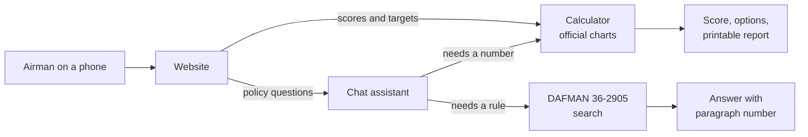

# Next Bracket

Physical Fitness Assessment (PFA) scoring and planning for United States Air Force Airmen.

## The problem

Three things get in the way when Airmen prepare for a PFA:

1. **Scoring means searching a chart.** The official scoring charts (effective 1 Mar 26) are long tables. Finding your points for your age, sex, and event means paging through a PDF.
2. **Planning means working the charts backward.** Current calculators take your results and return one total. To see what it takes to pass or reach 90, you run the "what if" math yourself and track where you can gain points.
3. **Policy answers disagree.** Questions like "Can I retest early?", "What if I'm on a profile for the run?", and "I just got back from deployment. Do I need to test right away?" are answered in [DAFMAN 36-2905](https://static.e-publishing.af.mil/production/1/af_a1/publication/afman36-2905/dafman36-2905.pdf), the manual that governs the fitness program. The manual is long and hard to search, so the same question often gets different answers.

## What it does

Next Bracket answers those three problems:

1. **Score it.** Enter your age, sex, and results. You get your PFA score from the official charts.
2. **Plan the next bracket.** Set a target, such as passing or 90. You see what you need on each event to reach it.
3. **Cite the rule.** Ask a policy question. The answer includes the DAFMAN 36-2905 paragraph number, so you can check the source. (Planned)

It is free, needs no login, and stores nothing you type.

This is not an official Air Force tool. Your Unit Fitness Assessment Cell (UFAC), Unit Fitness Program Manager (UFPM), and the current DAFMAN have the final word.

## Why I built this

I am a Peer Fitness Leader (PFL) for the maintenance group at the 129th Rescue Wing. Questions about PFA come up all the time. We ask around, go in loops, and end up with different interpretations of the same rule. I want one place where every answer shows its source. I am building it for my wing first, but the charts and the regulation apply to the whole Air Force.

## How to use it

The website is not live yet. When it is:

1. Open it on your phone. No account.
2. Enter your age and sex, then pick your events (for example the 2 mile run or the HAMR).
3. Type your results. The score updates as you type.
4. Set a target to see a few ways to reach it.
5. Ask a policy question. Each answer cites a paragraph.
6. Print a one-page report for your PFL or supervisor.

Developers can use the API today. See the [developer guide](#developer-guide).

## Goals

- Every answer shows its source: a chart version for scores, a paragraph number for policy.
- Numbers never come from AI. They come from tested code and the official charts.
- The calculator works with no AI at all.
- It works well on a phone.
- It stores nothing you type.

## Where it stands

Done:

- The official charts are turned into data and checked by hand against the PDF.
- The calculator scores all 8 events, every age band, and AFSPECWAR/EOD.
- The target planner gives three kinds of options: one event, quick wins, and balanced.
- The API serves `/health`, `/versions`, `/score`, `/plan`, and `/standards`.
- CI runs lint, types, and 274 automated tests on every push.

The API runs in a Docker image, locally with `docker compose`.

Next: the website and a first public release.

Later: the policy chat, the printable report, and the 2 km walk and body fat checks.

## Future ideas

A training plan is not in scope yet. It would take your current scores, your target, the weeks until your test, and the days you can train. It would build a plan from published exercise science and cite its sources, the same way the chat cites DAFMAN. It would not be medical advice, and it would not help anyone get around a profile.

## Report a problem

Found a wrong score, a bug, or an unclear doc? Open an issue with the [bug report form](https://github.com/tomtranjr/nextBracket/issues/new?template=bug_report.yml). For a wrong score, give your age, sex, event, and result, and the points you expected. Do not include your name, unit, or medical details.

---

# Developer guide

## Architecture

Scores and targets never go through AI. They come straight from the charts. The chat (planned) uses the same calculator for numbers and quotes DAFMAN for rules.



The website lives in `frontend/`. The backend lives in `backend/`.

```
backend/
  app/
    models.py       Pydantic schemas shared everywhere
    config.py       settings from NEXTBRACKET_* environment variables
    main.py         creates the FastAPI app
    core/           pure functions, no I/O, no LLM
      standards.py    parse the standards file, find a table, pick a version
      scoring.py      calculate_score
      planning.py     plan_to_target
      lookup.py       get_standards
      timeparse.py    mm:ss to seconds
    api/
      routes.py       the HTTP endpoints
      deps.py         the only place that reads files and the clock
  data/
    standards/      versioned scoring JSON (2026-03-01.json)
    sources/        the official charts PDF
  scripts/          extract_tables.py turns the charts PDF into JSON
  tests/
frontend/           Next.js site
  app/              routes and layout
  lib/
    api.ts            typed client for the API
    types.ts          request and response types, copied by hand from models.py
    time.ts           mm:ss to seconds, same rules as timeparse.py
```

The calculator form, policy search, and chat agent are not built yet. The form goes in `frontend/`. Search and chat go in `app/rag/` and `app/agent/`.

## How it works

- **Standards data.** `scripts/extract_tables.py` reads the charts PDF and writes `data/standards/<effective-date>.json`. The values are then checked by hand against the PDF.
- **Parse, don't validate.** `app/models.py` loads that file with strict Pydantic models. A file that parses has full coverage: every event, both sexes, and age bands with no gaps.
- **Pure core.** Each function in `app/core/` takes the parsed standards, a `Profile`, and results. It reads no disk and no clock, so tests need no files.
- **Thin API.** `routes.py` picks the standards version, calls one core function, and turns a `ValueError` into a 422. `deps.py` reads the files and the clock. Tests swap these with `app.dependency_overrides`.
- **Version rule.** With no `version` in the request, the API uses the newest standards file whose effective date is today or earlier.
- **Units are integers.** Reps, shuttles, and seconds. WHtR is in hundredths, so 0.49 is sent as `49`.
- **Scoring.** Each component takes one event. The composite is 0 to 100. Excellent is 90 or more. Satisfactory is 75 to 89.5. A missed component minimum is Unsatisfactory. A component with no result is listed in `not_scored`, and then there is no total.
- **Planning.** `plan_to_target` keeps each component's event (it never switches run to shuttle). A component with no result starts at its minimum. Options never repeat.

Events by component:

| Component | Max points | Minimum | Events |
| --- | --- | --- | --- |
| `cardio` | 50 | yes | `run_2mile` (seconds), `hamr_20m` (shuttles) |
| `strength` | 15 | yes | `push_up`, `hand_release_push_up` (reps) |
| `core` | 15 | yes | `sit_up`, `cross_leg_reverse_crunch` (reps), `forearm_plank` (seconds) |
| `body_comp` | 20 | no | `whtr` (hundredths) |

## Tech stack

| Part | Tool | Status |
| --- | --- | --- |
| API | Python 3.13, FastAPI, Pydantic | built |
| Calculator | Pure Python functions and versioned scoring tables (JSON) | built |
| Testing and quality | pytest, ruff, mypy, GitHub Actions | built |
| Container | Docker, Docker Compose | built |
| Hosting | Google Cloud Run | planned |
| Website | Next.js, TypeScript, Tailwind, on Vercel | scaffolded |
| Policy search | Postgres with pgvector (Supabase), full-text plus vector search | planned |
| Chat assistant | LangGraph agent with tools for scoring, planning, and search | planned |
| Evals and tracing | agent evals, LangSmith | planned |

## Set up and run the checks

You need [uv](https://docs.astral.sh/uv/).

```
cd backend
uv sync
uv run ruff check . && uv run ruff format --check .
uv run mypy app tests
uv run pytest
```

CI runs the same four checks on every push.

## Run the server

```
cd backend
uv run uvicorn app.main:app --reload
```

The server listens on `http://localhost:8000`. Open `http://localhost:8000/docs` for the interactive API docs.

To use a different folder of standards files, set `NEXTBRACKET_STANDARDS_DIR`.

A browser may call the API only from the sites in `NEXTBRACKET_CORS_ORIGINS`. The value is a JSON list. The default is `["http://localhost:3000"]`, the local website.

```
NEXTBRACKET_CORS_ORIGINS='["https://example.app"]' uv run uvicorn app.main:app
```

### Run with Docker

```
docker compose up --build
```

The API listens on `http://localhost:8000`, the same as above. The image listens on the `PORT` environment variable (default `8080`), because Cloud Run sets it. CI builds the image and calls `/health` on every push.

## Run the website

You need Node (see `frontend/.nvmrc`) and the API running on `http://localhost:8000`.

```
cd frontend
npm ci
npm run dev
```

The site listens on `http://localhost:3000`. To point it at another API, copy `.env.example` to `.env.local` and set `NEXT_PUBLIC_API_URL`. Next.js reads this value at build time and sends it to the browser, so it must not hold a secret.

Checks for the website:

```
npm run lint && npm run typecheck && npm test && npm run build
```

`frontend/lib/types.ts` is written by hand. When a model in `backend/app/models.py` changes, change the matching type there too.

## API reference

| Method | Path | Body | Returns |
| --- | --- | --- | --- |
| GET | `/health` | none | `{"status": "ok"}` |
| GET | `/versions` | none | the default version and all available versions |
| POST | `/score` | `profile`, `results`, optional `version` | a score report |
| POST | `/plan` | `profile`, `target`, optional `current`, optional `version` | ways to reach the target |
| POST | `/standards` | `profile`, optional `event`, optional `version` | the charts for that member |

Request fields:

- `profile`: `{"age": 17 to 70, "sex": "M" or "F", "is_afspecwar_eod": false}`. The last key is optional.
- `results` and `current`: `{"values": {"<event>": <integer>}}`. Give at most one event per component.
- `target`: total points, 0 to 100.
- `version`: a standards version such as `2026-03-01`.

Status codes:

- `200`: success. A target above the best total for the member is still 200, with `"status": "impossible"`.
- `422`: bad input. This covers a missing field, an unknown key, an age outside 17 to 70, a negative result, a target above 100, an unknown event or version, and two events in one component.
- `503`: `/versions` found no standards file in force today.

## Try it with curl

Start the server first. Pipe any command to `python3 -m json.tool` for readable output. Long responses below are shortened with `...`.

### Health

```
curl -s localhost:8000/health
```

```json
{"status":"ok"}
```

### Versions

```
curl -s localhost:8000/versions | python3 -m json.tool
```

```json
{
    "default": "2026-03-01",
    "versions": [
        {
            "version": "2026-03-01",
            "effective_date": "2026-03-01",
            "source": "PFRA Scoring Charts.pdf (Final USAF PFRA Scoring, effective 1 Mar 26)"
        }
    ]
}
```

### Score

A 27 year old male: 15:40 run (940 seconds), 45 push-ups, 50 sit-ups, WHtR 0.49.

```
curl -s -X POST localhost:8000/score -H 'content-type: application/json' \
  -d '{"profile":{"age":27,"sex":"M"},"results":{"values":{"run_2mile":940,"push_up":45,"sit_up":50,"whtr":49}}}' \
  | python3 -m json.tool
```

```json
{
    "version": "2026-03-01",
    "effective_date": "2026-03-01",
    "components": [
        {"component": "cardio", "event": "run_2mile", "result": 940, "points": 44.0, "max_points": 50, "minimum_met": true},
        {"component": "strength", "event": "push_up", "result": 45, "points": 8.5, "max_points": 15, "minimum_met": true},
        {"component": "core", "event": "sit_up", "result": 50, "points": 12.0, "max_points": 15, "minimum_met": true},
        {"component": "body_comp", "event": "whtr", "result": 49, "points": 20.0, "max_points": 20, "minimum_met": null}
    ],
    "not_scored": [],
    "total": 84.5,
    "category": "satisfactory",
    "missed_minimums": []
}
```

The real response prints each component over several lines. It is shown on one line here to save space. If you leave out an event, it appears in `not_scored`, and `total` and `category` are `null`.

### Plan

The same member, with a target of 90.

```
curl -s -X POST localhost:8000/plan -H 'content-type: application/json' \
  -d '{"profile":{"age":27,"sex":"M"},"target":90,"current":{"values":{"run_2mile":940,"push_up":45,"sit_up":50,"whtr":49}}}' \
  | python3 -m json.tool
```

```json
{
    "version": "2026-03-01",
    "effective_date": "2026-03-01",
    "target": 90.0,
    "status": "options",
    "current_total": 84.5,
    "max_total": 100.0,
    "assumed_components": [],
    "options": [
        {
            "kind": "single_event",
            "changes": [
                {"component": "cardio", "event": "run_2mile", "unit": "seconds", "from_result": 940, "to_result": 834, "delta": -106, "from_points": 44.0, "to_points": 49.5}
            ],
            "projected_total": 90.0
        },
        ...
    ]
}
```

The response has four options: `single_event` for the run, `single_event` for push-ups, `quick_wins`, and `balanced`. Each one reaches 90.0. A `delta` of `-106` on the run means 106 seconds faster.

`status` is one of `already_met`, `options`, or `impossible`. Leave out `current` to plan from the component minimums. Those components are then listed in `assumed_components`.

### Standards

The push-up chart for a 27 year old male.

```
curl -s -X POST localhost:8000/standards -H 'content-type: application/json' \
  -d '{"profile":{"age":27,"sex":"M"},"event":"push_up"}' \
  | python3 -m json.tool
```

```json
{
    "version": "2026-03-01",
    "effective_date": "2026-03-01",
    "passing_total": 75,
    "components": [
        {
            "component": "strength",
            "max_points": 15,
            "has_minimum": true,
            "tables": [
                {
                    "sex": "M",
                    "age_min": 25,
                    "age_max": 29,
                    "event": "push_up",
                    "unit": "reps",
                    "higher_is_better": true,
                    "component_minimum": 28,
                    "brackets": [
                        {"threshold": 63, "points": 15.0},
                        {"threshold": 62, "points": 14.5},
                        ...
                    ]
                }
            ]
        }
    ]
}
```

Leave out `event` to get every event. Run and HAMR then appear together under `cardio`.

### Errors

A target above 100:

```
curl -s -w '\n%{http_code}\n' -X POST localhost:8000/plan -H 'content-type: application/json' \
  -d '{"profile":{"age":27,"sex":"M"},"target":150}'
```

```
{"detail":[{"type":"less_than_equal","loc":["body","target"],"msg":"Input should be less than or equal to 100","input":150,"ctx":{"le":100.0}}]}
422
```

An unknown event:

```
curl -s -w '\n%{http_code}\n' -X POST localhost:8000/standards -H 'content-type: application/json' \
  -d '{"profile":{"age":27,"sex":"M"},"event":"nope"}'
```

```
{"detail":"unknown event: 'nope'"}
422
```
