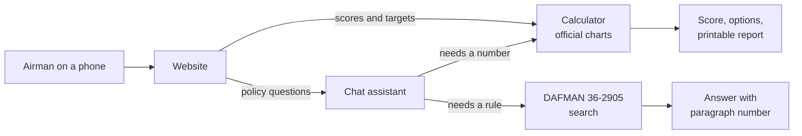

# Next Bracket

PFA scoring and planning for Airmen.

## What this is

Fitness questions come up all the time, and people often get different answers to the same one. "How many push-ups do I need at 31?" "Can I retest early?" "What if I'm on a profile for the run?"

The answers are in DAFMAN 36-2905 and the scoring charts. Both are long and hard to search on a phone. Next Bracket will do three things:

- Score your PFA from the official charts (effective 1 Mar 26).
- Show what you need to reach a target, like passing or 90.
- Answer policy questions and give the DAFMAN paragraph number, so you can check the source.

It is free, needs no login, and stores nothing you type.

This is not an official Air Force tool. Your Fitness Assessment Cell and the current DAFMAN have the final word.

## Why I built this

I am a PFL/PTL for the maintenance group at the 129th Rescue Wing. People ask me fitness questions all day. We ask around, go in loops, and end up with different readings of the same rule. I want one place where every answer shows its source. I am building it for my wing first, but the charts and the regulation apply to the whole Air Force.

## How to use it

The website is not live yet. When it is:

1. Open it on your phone. No account.
2. Enter your age and sex, then pick your events (for example the 2 mile run or the HAMR).
3. Type your results. The score updates as you type.
4. Set a target to see a few ways to reach it.
5. Ask a policy question. Each answer cites a paragraph.
6. Print a one-page report for your PTL or supervisor.

## Where it stands

Done:

- The official charts are turned into data and checked by hand against the PDF.
- The calculator scores all 8 events, every age band, and AFSPECWAR/EOD.
- 163 automated tests check it.

Next: the target planner, the API, the website, and a first public release.

Later: the policy chat and the printable report.

## Future ideas

A training plan is not in scope yet. It would take your current scores, your target, the weeks until your test, and the days you can train. It would build a plan from published exercise science and cite its sources, the same way the chat cites DAFMAN. It would not be medical advice, and it would not help anyone get around a profile.

## How it works

Scores and targets never go through AI. They come straight from the charts. The chat uses the same calculator for numbers and quotes DAFMAN for rules.



## Tech stack (planned)

| Part | Tool |
|---|---|
| Website | Next.js, TypeScript, Tailwind, on Vercel |
| API | Python 3.13, FastAPI, Pydantic, on Google Cloud Run (Docker) |
| Calculator | Pure Python functions and versioned scoring tables (JSON) |
| Policy search | Postgres with pgvector (Supabase), full-text plus vector search |
| Chat assistant | LangGraph agent with tools for scoring, planning, and search |
| Testing and quality | pytest, ruff, mypy, agent evals, LangSmith tracing |
| CI/CD | GitHub Actions |

## Run the checks

You need [uv](https://docs.astral.sh/uv/).

```
cd backend
uv sync
uv run ruff check . && uv run ruff format --check .
uv run mypy app tests
uv run pytest
```

## Run the API

```
cd backend
uv run uvicorn app.main:app --reload
```

Open `http://localhost:8000/docs` to try `/health`, `/versions`, and `/score`.
