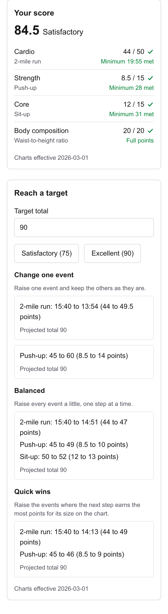
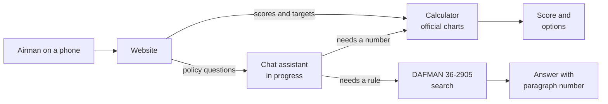

# Next Bracket

**Score your Air Force PFA and see exactly what it takes to reach the next bracket.**

Try it: **[nextbracket-five.vercel.app](https://nextbracket-five.vercel.app)**. Free, no login, works on your phone.

## The problem

Every Airman takes the Physical Fitness Assessment (PFA). The scoring charts are 11 pages of tables. Today's calculators read those tables for you and hand back one number. They don't answer the question Airmen actually ask: **"What do I need to do to pass, or to hit 90?"**

To answer that, you work the charts backward by hand. Policy questions are worse. "Can I retest early?" or "Do I test right after a deployment?" get different answers from different people, because the rule is buried in a 116-page manual.

| | Today's calculators | Next Bracket |
| --- | --- | --- |
| Score | One total | The total, plus each component's points, minimum, and gap |
| Planning | Work the charts backward yourself | Set a target and get three ways to reach it |
| Trust | No source shown | Every score is stamped with the chart version it used |
| Policy | Ask around | An answer that cites the DAFMAN paragraph *(in progress)* |

## See it work

A 27 year old male with a 15:40 run, 45 push-ups, and 50 sit-ups scores 84.5. Set a target of 90 and the planner shows three ways to get there. One way is to cut the run to 13:54. Another, "quick wins," is to run 14:13 and do one more push-up.

## What it does today

- **Scores as you type.** All 8 events, every age band, both sexes, and the AFSPECWAR/EOD chart. Each component shows whether you met its minimum and by how much.
- **Plans the next bracket.** Pick a target such as 75 or 90. You get three options: raise one event, take the quick wins, or spread the work across events. Tests re-score every option to prove it hits the target and meets every minimum.
- **Follows the regulation to the letter.** Enter your waist and height and the app truncates the ratio to two decimals, as DAFMAN 36-2905 para 3.15.4.2 requires. It never rounds up in your favor.
- **Built for the track, not the desk.** Type a run time as `15:40`, `15.40`, or `1540` on a phone keypad. Nothing you type is stored or logged.

## Why I built this

I'm a Peer Fitness Leader for the maintenance group at the 129th Rescue Wing. PFA questions come up every week. We ask around, go in circles, and end up with different readings of the same rule. I wanted one place where every answer shows its source.

I built it for my wing first. The charts and the regulation apply to the whole Air Force.

## Try it and tell me

I'm now sharing Next Bracket with Airmen at the 129th Rescue Wing for feedback. If you use it, I want to hear what works and what doesn't.

- Use it: [nextbracket-five.vercel.app](https://nextbracket-five.vercel.app)
- Report a wrong score or a bug: [bug report form](https://github.com/tomtranjr/nextBracket/issues/new?template=bug_report.yml). For a wrong score, give your age, sex, event, result, and the points you expected. Do not include your name, unit, or medical details.

## How it's built

The design choices that matter:

- **The AI never computes a score.** Every number comes from tested Python functions. The planned chat assistant will call the same calculator as a tool, and the calculator works with no AI at all.
- **The data is extracted, then checked by hand.** A script turns the official charts PDF into 144 versioned tables. I checked the values against the PDF, and the tests score every bracket in every table.
- **A pure core.** Scoring and planning are pure functions with no disk, clock, or network access. The FastAPI layer is thin, so the logic is easy to test and to reuse from an agent.
- **Measure before adding.** For the AI work, I write the eval first. A component like reranking goes in only when an eval shows it helps, with before and after numbers.
- **Shipped like production.** CI runs lint, type checks, and tests on every push. Each deploy starts a new Cloud Run revision with no traffic, checks `/health` and a known score, and only then moves traffic over. The API is rate limited and stores no user input.

| Part | Tools | Status |
| --- | --- | --- |
| Calculator and planner | Python 3.13, Pydantic, versioned JSON standards | Live |
| API | FastAPI on Google Cloud Run, Docker | Live |
| Website | Next.js, TypeScript, Tailwind on Vercel | Live |
| CI/CD | GitHub Actions, pytest, ruff, mypy, Vitest | Live |
| Policy search | Postgres with pgvector, full-text plus vector search | Planned |
| Chat assistant | LangGraph agent with scoring, planning, and search tools | Planned |
| Evals and tracing | Agent evals, LangSmith | Planned |

To run it locally, call the API, or see how it's deployed, read the [developer guide](docs/developer-guide.md).

## What's next

1. The 2 km walk and body fat assessment checks.
2. The cited policy chat: DAFMAN 36-2905 split by paragraph, hybrid search, and an agent with evals.
3. A one-page printable report for your PFL or supervisor.

Later: a training plan that takes your scores, your target, and the weeks until your test, and cites its exercise science sources.

---

Next Bracket is not an official Air Force tool. Your Unit Fitness Assessment Cell (UFAC), Unit Fitness Program Manager (UFPM), and the current [DAFMAN 36-2905](https://static.e-publishing.af.mil/production/1/af_a1/publication/afman36-2905/dafman36-2905.pdf) have the final word.
