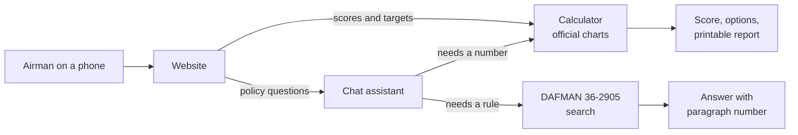

# Developer guide

How Next Bracket is built, how to run it, and how to call the API. For the project overview, see the [README](../README.md).

## Architecture

Scores and targets never go through AI. They come straight from the charts. The chat (planned) uses the same calculator for numbers and quotes DAFMAN for rules.



The website lives in `frontend/`. The backend lives in `backend/`.

```
backend/
  app/
    models.py       Pydantic schemas shared everywhere
    config.py       settings from NEXTBRACKET_* environment variables
    main.py         creates the FastAPI app
    core/           pure functions, no I/O, no LLM
      standards.py    parse the standards file, find a table, pick a version
      scoring.py      calculate_score
      planning.py     plan_to_target
      lookup.py       get_standards
      timeparse.py    mm:ss to seconds
    api/
      routes.py       the HTTP endpoints
      deps.py         the only place that reads files and the clock
      ratelimit.py    in-memory rate limit (per client and global)
  data/
    standards/      versioned scoring JSON (2026-03-01.json)
    sources/        the official charts PDF
  scripts/          extract_tables.py turns the charts PDF into JSON
  tests/
frontend/           Next.js site
  app/              routes and layout
  lib/
    api.ts            typed client for the API
    types.ts          request and response types, copied by hand from models.py
    time.ts           seconds to m:ss for display
    score-form.ts     reads the form; times come from a minutes box and a seconds box
```

Policy search and the chat agent are planned. They go in `app/rag/` and `app/agent/`.

## How it works

- **Standards data.** `scripts/extract_tables.py` reads the charts PDF and writes `data/standards/<effective-date>.json`. The values are then checked by hand against the PDF.
- **Parse, don't validate.** `app/models.py` loads that file with strict Pydantic models. A file that parses has full coverage: every event, both sexes, and age bands with no gaps.
- **Pure core.** Each function in `app/core/` takes the parsed standards, a `Profile`, and results. It reads no disk and no clock, so tests need no files.
- **Thin API.** `routes.py` picks the standards version, calls one core function, and turns a `ValueError` into a 422. `deps.py` reads the files and the clock. Tests swap these with `app.dependency_overrides`.
- **Version rule.** With no `version` in the request, the API uses the newest standards file whose effective date is today or earlier.
- **Units are integers.** Reps, shuttles, and seconds. WHtR is in hundredths, so 0.49 is sent as `49`.
- **Scoring.** Each component takes one event. The composite is 0 to 100. Excellent is 90 or more. Satisfactory is 75 to 89.5. A missed component minimum is Unsatisfactory. A component with no result is listed in `not_scored`, and then there is no total.
- **Planning.** `plan_to_target` keeps each component's event (it never switches run to shuttle). A component with no result starts at its minimum. Options never repeat.

Events by component:

| Component | Max points | Minimum | Events |
| --- | --- | --- | --- |
| `cardio` | 50 | yes | `run_2mile` (seconds), `hamr_20m` (shuttles) |
| `strength` | 15 | yes | `push_up`, `hand_release_push_up` (reps) |
| `core` | 15 | yes | `sit_up`, `cross_leg_reverse_crunch` (reps), `forearm_plank` (seconds) |
| `body_comp` | 20 | no | `whtr` (hundredths) |

## Tech stack

| Part | Tool | Status |
| --- | --- | --- |
| API | Python 3.13, FastAPI, Pydantic | built |
| Calculator | Pure Python functions and versioned scoring tables (JSON) | built |
| Testing and quality | pytest, ruff, mypy, GitHub Actions | built |
| Container | Docker, Docker Compose | built |
| Hosting | Google Cloud Run (API), Vercel (website) | built |
| Website | Next.js, TypeScript, Tailwind, on Vercel | calculator and planner built, deployed at https://nextbracket-five.vercel.app |
| Policy search | Postgres with pgvector (Supabase), full-text plus vector search | planned |
| Chat assistant | LangGraph agent with tools for scoring, planning, and search | planned |
| Evals and tracing | agent evals, LangSmith | planned |

## Set up and run the checks

You need [uv](https://docs.astral.sh/uv/).

```
cd backend
uv sync
uv run ruff check . && uv run ruff format --check .
uv run mypy app tests
uv run pytest
```

CI runs the same four checks on every push.

## Run the server

```
cd backend
uv run uvicorn app.main:app --reload
```

The server listens on `http://localhost:8000`. Open `http://localhost:8000/docs` for the interactive API docs.

To use a different folder of standards files, set `NEXTBRACKET_STANDARDS_DIR`.

A browser may call the API only from the sites in `NEXTBRACKET_CORS_ORIGINS`. The value is a JSON list. The default is `["http://localhost:3000"]`, the local website.

```
NEXTBRACKET_CORS_ORIGINS='["https://example.app"]' uv run uvicorn app.main:app
```

### Rate limit

The API limits requests to protect against floods and runaway cost. Each client address gets 60 requests a minute, and all clients together get 600. Past a limit, the API answers `429` with a `Retry-After` header (seconds to wait). `/health` and CORS preflight (`OPTIONS`) requests are never limited. A preflight runs no endpoint code, so it costs about the same as a `429`. Set `NEXTBRACKET_RATE_LIMIT_PER_IP` and `NEXTBRACKET_RATE_LIMIT_GLOBAL` to change the limits, and use `0` to turn one off.

The counters live in memory, so they are exact only while one process serves all traffic. Cloud Run is set to a single instance for this reason. The limiter reads the client address from the last `X-Forwarded-For` entry, which Cloud Run sets. It keeps no address after the minute ends.

### Run with Docker

```
docker compose up --build
```

The API listens on `http://localhost:8000`, the same as above. The image listens on the `PORT` environment variable (default `8080`), because Cloud Run sets it. CI builds the image and calls `/health` on every push.

### Deploy

The API runs on Google Cloud Run. The `deploy` workflow starts after the `ci` workflow passes on `main`. You can also run it by hand from `main` with the "Run workflow" button. A manual run deploys only if `ci` passed for that commit.

The workflow builds the image, tags it with the commit SHA, and pushes it to Artifact Registry. It then deploys a new revision with no traffic and calls `/health` and `/score` on it. Traffic moves to the new revision only if both answers are right. A failed check leaves the old revision live. The very first deploy is the exception, because Cloud Run cannot create a service without traffic.

The workflow logs in with Workload Identity Federation, so the repository holds no key file. It reads these repository variables, which are not secrets: `GCP_PROJECT_ID`, `GCP_REGION`, `GCP_WORKLOAD_IDENTITY_PROVIDER`, `GCP_DEPLOYER_SERVICE_ACCOUNT`, `GCP_RUNTIME_SERVICE_ACCOUNT`, and `CORS_ORIGINS`.

The service runs at most one instance per revision and scales to zero when idle. One instance keeps the in-memory rate limit exact. During a deploy the new revision runs next to the live one for a short time, so up to two instances can run, each with its own counters. The first request after an idle period waits a few seconds for a cold start. The website calls `/health` when the page loads to start the API early, and shows "Scoring..." while it waits. A failed call shows what went wrong (no connection, too many requests, or a service error) and a "Try again" button.

The workflow sets `NEXTBRACKET_CORS_ORIGINS` on every deploy from the `CORS_ORIGINS` variable, a JSON list such as `["https://nextbracket-five.vercel.app"]`. Each entry must be a scheme, a host, and an optional port, with no path, query, or trailing slash, the way a browser sends it. A missing or bad value stops the deploy, so the API never falls back to the localhost default by accident. The smoke test also checks that the first origin in the list gets its CORS header back.

The website runs on Vercel. Vercel's GitHub integration builds `frontend/` and deploys every push to `main` to production. It does not wait for the `ci` workflow. `NEXT_PUBLIC_API_URL` is set in the Vercel project for Production only. Vercel also builds a preview for every other branch. A preview has its own URL, which is not in `CORS_ORIGINS`, so its form cannot reach the API. Previews only prove that the site builds.

## Run the website

You need Node (see `frontend/.nvmrc`) and the API running on `http://localhost:8000`.

```
cd frontend
npm ci
npm run dev
```

The site listens on `http://localhost:3000`. Enter your age, sex, and results. Times use a minutes box and a seconds box, with no ":" to type. A blank box counts as 0, and seconds must be 0 to 59. The form scores them live against the API, so keep the API running. Body composition takes waist and height in inches first, or the ratio. The site truncates the ratio to two decimals, as DAFMAN 36-2905 para 3.15.4.2 requires, and says so on screen. Each score row shows a green check, an amber minus, or a red X, with a short note. Green means the component minimum is met, or full points for body composition. Amber means partial points for body composition. Red means the minimum is missed, or 0 points for body composition. Age and sex start blank on purpose. To point it at another API, copy `.env.example` to `.env.local` and set `NEXT_PUBLIC_API_URL`. Next.js reads this value at build time and sends it to the browser, so it must not hold a secret.

Checks for the website:

```
npm run lint && npm run typecheck && npm test && npm run build
```

`frontend/lib/types.ts` is written by hand. When a model in `backend/app/models.py` changes, change the matching type there too.

### Privacy

Nothing you type is stored or logged. The site holds your inputs in the page only, and the API logs the method, path, and status, not the request body.

The live site uses Vercel Web Analytics and Speed Insights to count page views and measure load speed. They send no form values, and the site sends no custom events. In local development they send nothing.

Vercel and Cloud Run keep their own platform request logs, which include the client address. We do not control how long they keep them.

## API reference

| Method | Path | Body | Returns |
| --- | --- | --- | --- |
| GET | `/health` | none | `{"status": "ok"}` |
| GET | `/versions` | none | the default version and all available versions |
| POST | `/score` | `profile`, `results`, optional `version` | a score report |
| POST | `/plan` | `profile`, `target`, optional `current`, optional `version` | ways to reach the target |
| POST | `/standards` | `profile`, optional `event`, optional `version` | the charts for that member |

Request fields:

- `profile`: `{"age": 17 to 70, "sex": "M" or "F", "is_afspecwar_eod": false}`. The last key is optional.
- `results` and `current`: `{"values": {"<event>": <integer>}}`. Give at most one event per component.
- `target`: total points, 0 to 100.
- `version`: a standards version such as `2026-03-01`.

Status codes:

- `200`: success. A target above the best total for the member is still 200, with `"status": "impossible"`.
- `422`: bad input. This covers a missing field, an unknown key, an age outside 17 to 70, a negative result, a target above 100, an unknown event or version, and two events in one component.
- `503`: `/versions` found no standards file in force today.

## Try it with curl

Start the server first. Pipe any command to `python3 -m json.tool` for readable output. Long responses below are shortened with `...`.

### Health

```
curl -s localhost:8000/health
```

```json
{"status":"ok"}
```

### Versions

```
curl -s localhost:8000/versions | python3 -m json.tool
```

```json
{
    "default": "2026-03-01",
    "versions": [
        {
            "version": "2026-03-01",
            "effective_date": "2026-03-01",
            "source": "PFRA Scoring Charts.pdf (Final USAF PFRA Scoring, effective 1 Mar 26)"
        }
    ]
}
```

### Score

A 27 year old male: 15:40 run (940 seconds), 45 push-ups, 50 sit-ups, WHtR 0.49.

```
curl -s -X POST localhost:8000/score -H 'content-type: application/json' \
  -d '{"profile":{"age":27,"sex":"M"},"results":{"values":{"run_2mile":940,"push_up":45,"sit_up":50,"whtr":49}}}' \
  | python3 -m json.tool
```

```json
{
    "version": "2026-03-01",
    "effective_date": "2026-03-01",
    "components": [
        {"component": "cardio", "event": "run_2mile", "result": 940, "points": 44.0, "max_points": 50, "minimum_met": true, "minimum": 1195, "minimum_gap": null, "full_points_at": 815, "full_points_gap": 125},
        {"component": "strength", "event": "push_up", "result": 45, "points": 8.5, "max_points": 15, "minimum_met": true, "minimum": 28, "minimum_gap": null, "full_points_at": 63, "full_points_gap": 18},
        {"component": "core", "event": "sit_up", "result": 50, "points": 12.0, "max_points": 15, "minimum_met": true, "minimum": 31, "minimum_gap": null, "full_points_at": 56, "full_points_gap": 6},
        {"component": "body_comp", "event": "whtr", "result": 49, "points": 20.0, "max_points": 20, "minimum_met": null, "minimum": null, "minimum_gap": null, "full_points_at": 49, "full_points_gap": null}
    ],
    "not_scored": [],
    "total": 84.5,
    "category": "satisfactory",
    "missed_minimums": []
}
```

The real response prints each component over several lines. It is shown on one line here to save space. If you leave out an event, it appears in `not_scored`, and `total` and `category` are `null`.

### Plan

The same member, with a target of 90.

```
curl -s -X POST localhost:8000/plan -H 'content-type: application/json' \
  -d '{"profile":{"age":27,"sex":"M"},"target":90,"current":{"values":{"run_2mile":940,"push_up":45,"sit_up":50,"whtr":49}}}' \
  | python3 -m json.tool
```

```json
{
    "version": "2026-03-01",
    "effective_date": "2026-03-01",
    "target": 90.0,
    "status": "options",
    "current_total": 84.5,
    "max_total": 100.0,
    "assumed_components": [],
    "options": [
        {
            "kind": "single_event",
            "changes": [
                {"component": "cardio", "event": "run_2mile", "unit": "seconds", "from_result": 940, "to_result": 834, "delta": -106, "from_points": 44.0, "to_points": 49.5}
            ],
            "projected_total": 90.0
        },
        ...
    ]
}
```

The response has four options: `single_event` for the run, `single_event` for push-ups, `quick_wins`, and `balanced`. Each one reaches 90.0. A `delta` of `-106` on the run means 106 seconds faster.

`status` is one of `already_met`, `options`, or `impossible`. Leave out `current` to plan from the component minimums. Those components are then listed in `assumed_components`.

### Standards

The push-up chart for a 27 year old male.

```
curl -s -X POST localhost:8000/standards -H 'content-type: application/json' \
  -d '{"profile":{"age":27,"sex":"M"},"event":"push_up"}' \
  | python3 -m json.tool
```

```json
{
    "version": "2026-03-01",
    "effective_date": "2026-03-01",
    "passing_total": 75,
    "components": [
        {
            "component": "strength",
            "max_points": 15,
            "has_minimum": true,
            "tables": [
                {
                    "sex": "M",
                    "age_min": 25,
                    "age_max": 29,
                    "event": "push_up",
                    "unit": "reps",
                    "higher_is_better": true,
                    "component_minimum": 28,
                    "brackets": [
                        {"threshold": 63, "points": 15.0},
                        {"threshold": 62, "points": 14.5},
                        ...
                    ]
                }
            ]
        }
    ]
}
```

Leave out `event` to get every event. Run and HAMR then appear together under `cardio`.

### Errors

A target above 100:

```
curl -s -w '\n%{http_code}\n' -X POST localhost:8000/plan -H 'content-type: application/json' \
  -d '{"profile":{"age":27,"sex":"M"},"target":150}'
```

```
{"detail":[{"type":"less_than_equal","loc":["body","target"],"msg":"Input should be less than or equal to 100","input":150,"ctx":{"le":100.0}}]}
422
```

An unknown event:

```
curl -s -w '\n%{http_code}\n' -X POST localhost:8000/standards -H 'content-type: application/json' \
  -d '{"profile":{"age":27,"sex":"M"},"event":"nope"}'
```

```
{"detail":"unknown event: 'nope'"}
422
```
